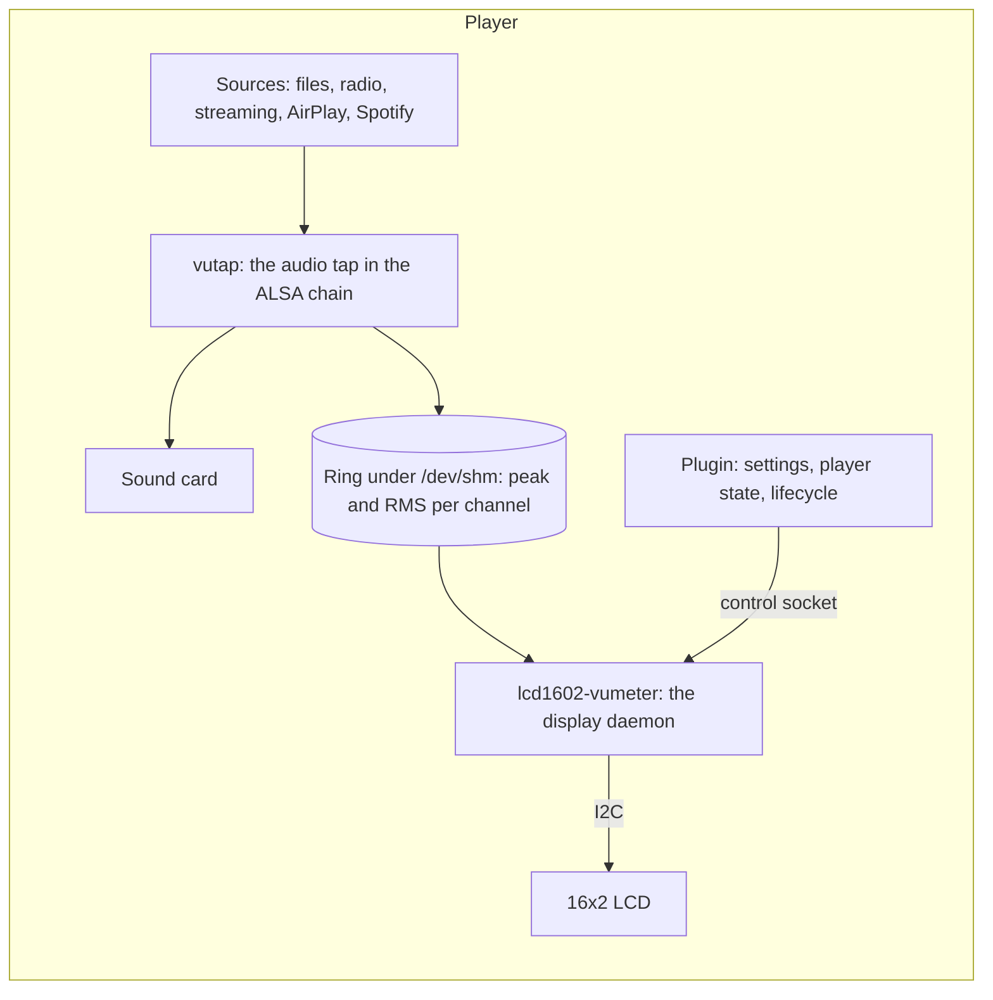

# LCD1602 VU Meter

Two VU bars on a 16x2 character LCD, moving with the music on a Volumio player. A Volumio plugin written in Rust: an audio tap in the player's ALSA chain measures every source, files, radio, streaming, AirPlay and Spotify alike, without touching the sound; a small daemon draws the bars, the player's state, a standby clock and date, and says when the system boots, restarts and shuts down. Works with the Waveshare LCD1602 I2C and RGB modules, Grove and DFRobot RGB LCDs, the common PCF8574 backpack, and ST7032 and US2066 modules.

<p align="center"></p>

The workspace version is **0.1.0**.

## Get it

Download the plugin zip from the [releases](https://github.com/foonerd/lcd1602-vumeter/releases) and install it by hand as the [Quick Start](https://github.com/foonerd/lcd1602-vumeter/wiki/Quick-Start) shows: `miniunzip` into a folder on the player, `volumio plugin install` from it. Once it has been through field testing and Volumio's review it will be in the plugin store. The [wiki](https://github.com/foonerd/lcd1602-vumeter/wiki) has the [wiring](https://github.com/foonerd/lcd1602-vumeter/wiki/Wiring), the [supported displays](https://github.com/foonerd/lcd1602-vumeter/wiki/Displays), every [setting](https://github.com/foonerd/lcd1602-vumeter/wiki/Settings) and the [troubleshooting](https://github.com/foonerd/lcd1602-vumeter/wiki/Troubleshooting) page.

| Player | Volumio 4 on a Raspberry Pi 3, 4, 5 or Zero 2 W (32- or 64-bit image), or a PC with a USB I2C adapter. |
| --- | --- |
| Display | Any 16x2 character module with an I2C controller or backpack; see [Displays](https://github.com/foonerd/lcd1602-vumeter/wiki/Displays). |
| Wiring | Four wires: 3.3 V or 5 V, GND, SDA, SCL. |

## What is in the box



| Part | Where | What it does |
| --- | --- | --- |
| `vutap` | `crates/vutap` | What the tap measures and the ring it shares them through: sample layouts for every ALSA format, the relay between the audio thread and the measuring thread, peak and RMS per hop, the density level of DSD and DoP. |
| `vutap-alsa` | `bins/vutap-alsa` | The ALSA PCM plugin (`libvutap.so`, `type vutap`): heads the player's chain, passes every stream through byte for byte, and measures it on a thread of its own. |
| `panel` | `crates/panel` | The display: the HD44780 command set over the native I2C controllers (AiP31068, ST7032, US2066) and the PCF8574 backpack, the RGB backlight drivers, the bar glyphs and large digits, a simulator and an SVG renderer. |
| `lcd1602-vumeter` | `bins/lcd1602-vumeter` | The daemon: reads the ring and the player's state, draws the bars with VU ballistics and a peak hold, the pause and standby screens, the lifecycle messages; `--probe`, `--say`, `--test`, `--ping` and `--render` on the command line. |
| The plugin | `plugin/` | The Volumio plugin: `index.js` and the settings page at the root, the ALSA contribution template under `alsa/`, the tap under `alsa-lib/<arch>/`, the daemon under `bin/<arch>/`, the service unit under `systemd/`, the launcher and the architecture probe under `scripts/`, helper modules under `lib/`. |

## Build

The toolchain is pinned by `rust-toolchain.toml`; the cross linkers are named in `.cargo/config.toml` (`gcc-arm-linux-gnueabihf`, `gcc-aarch64-linux-gnu`).

```sh
scripts/check.sh     # format, clippy, tests, docs, glibc ceiling, renders, plugin files and tests
scripts/ship.sh      # the daemon and the tap for armhf, arm64 and amd64 into bin/ and lib/
scripts/package.sh   # the plugin zip into dist/
```

Every shipped binary must load on Volumio's glibc 2.36; `ship.sh` refuses one that does not. Without the cross compilers on the machine, the builder image of `scripts/builder/Dockerfile` has everything:

```sh
docker build -t lcd1602-builder -f scripts/builder/Dockerfile .
docker run --rm --user "$(id -u):$(id -g)" -v "$PWD:/work" -w /work lcd1602-builder sh -c 'scripts/ship.sh && scripts/package.sh'
```

## License

MIT. The audio tap descends from the tap of [glass](https://github.com/foonerd/glass), MIT.
